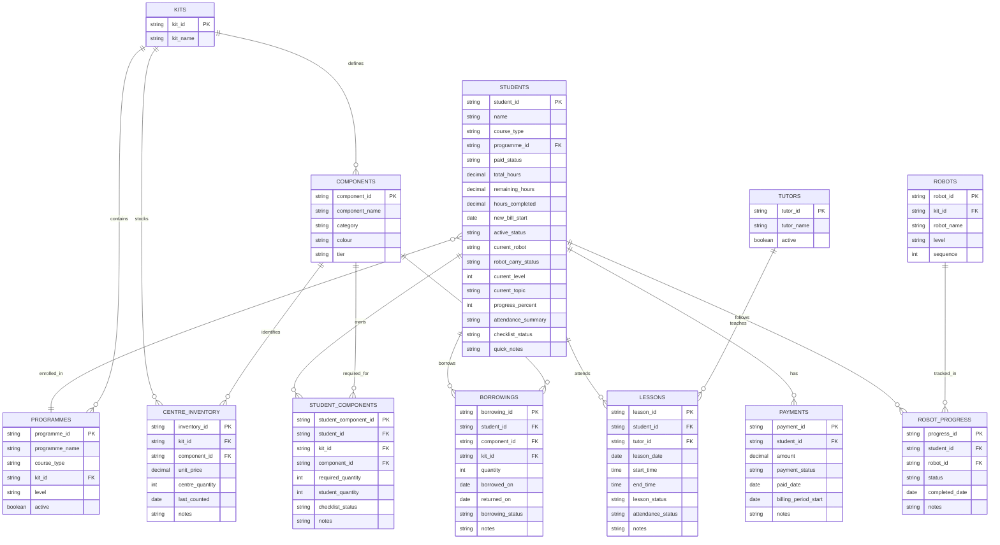

# ICC Operations Database ER Diagram

## Important Keys

- Use `student_id` in every student-related table. Do not join records by student name.
- Use `kit_id + component_id` for centre inventory because the same component name can mean different items in different kits.
- Use `lesson_date` to build the Today's Students page.
- Keep centre inventory separate from student checklist quantities.
- Keep JWT authentication outside this database relationship layer; protected API routes should validate the Bearer token before querying these tables.
